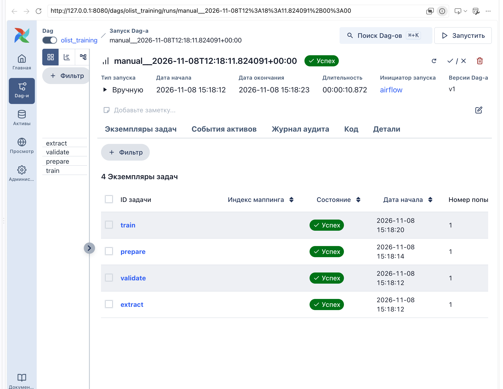
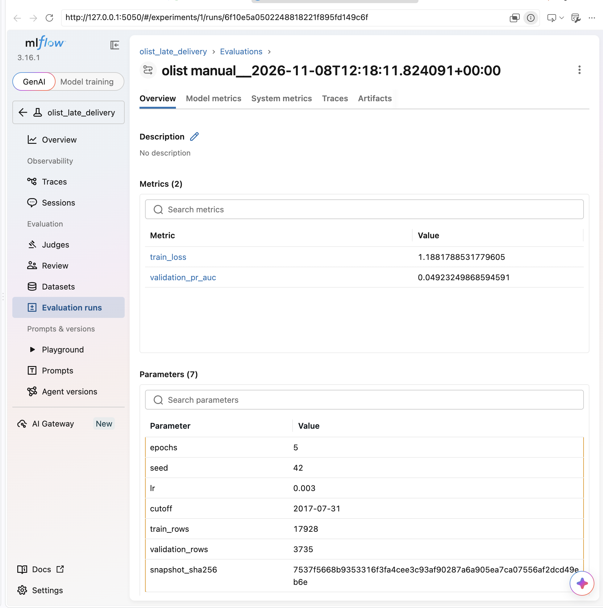

# ДЗ 2. Локальный ML-пайплайн Olist: PostgreSQL -> Airflow -> MLflow

Условие в [ASSIGNMENT.md](ASSIGNMENT.md). Данные, модель (`src/olist_model.py`) и проверка (`src/check_model.py`) выданы и не менялись. Моя часть:

- `src/olist_pipeline.py`: этапы `extract`, `validate`, `prepare`, `train`;
- `dags/olist_training.py`: DAG `olist_training`;
- `compose.yaml`: сервис `mlflow` и зависимость Airflow от него.

## Запуск от git clone

Нужны Git, Docker с Linux engine и Docker Compose v2; для Docker не меньше 4 ГБ RAM и 2 CPU. Обучение идёт на CPU внутри контейнера.

```bash
git clone https://github.com/IvanEvtushenko/MIPT_2026_hw_.git
cd MIPT_2026_hw_/pytorch/hw_02
cp .env.example .env
docker compose up -d --build
docker compose ps        # source, mlflow и airflow должны стать healthy
```

Первая сборка скачивает образы Airflow, PostgreSQL, MLflow и torch для CPU; на Apple M3 Pro сборка и подъём заняли около 7 минут. Все дальнейшие команды выполняются из каталога `pytorch/hw_02`.

## Адреса интерфейсов

| Сервис | С компьютера | Из контейнера Airflow |
| --- | --- | --- |
| Airflow, без пароля | http://127.0.0.1:8080 | |
| MLflow | http://127.0.0.1:5050 | http://mlflow:5000 |

Оба порта опубликованы только на `127.0.0.1`. Проверка MLflow из Airflow:

```bash
docker compose exec -T airflow python -c "import urllib.request; print(urllib.request.urlopen('http://mlflow:5000/health', timeout=5).read())"
```

## Запуск DAG

В интерфейсе Airflow включите `olist_training` и нажмите Trigger. То же из терминала:

```bash
docker compose exec -T airflow airflow dags unpause olist_training
docker compose exec -T airflow airflow dags trigger olist_training
```

При включении DAG сам создаёт один плановый запуск за текущую неделю: расписание `@weekly`, `catchup=False`.

| Задача | Что делает | Что уходит в XCom |
| --- | --- | --- |
| `extract` | читает `public.orders` из PostgreSQL по `DATABASE_URL`, пишет UTF-8 CSV | абсолютный путь к снимку |
| `validate` | только читает CSV: не пусто, все 13 столбцов, `order_id` уникален, числа конечные, `late` равен 0 или 1, даты разбираются | тот же путь |
| `prepare` | считает SHA256 байтов снимка, делит по времени `split_by_time` с `OLIST_CUTOFF`, пишет train и validation | пути, SHA256, cutoff, число строк |
| `train` | обучает выданную модель, пишет эксперимент и модель в MLflow | MLflow `run_id` |

Настройки DAG: `max_active_runs=1`, лимит времени у каждой задачи, у `extract` 3 повтора с паузой 30 с, у `validate` `retries=0`, у `validate`, `prepare`, `train` `trigger_rule='all_success'`.

Каждый запуск пишет файлы в свой каталог `/opt/olist/work/runs/<run_id>/`: `snapshot.csv`, `train.csv`, `validation.csv` и `model/`. Поэтому повторный запуск не дописывает строки к старому снимку.

## Эксперимент в MLflow

Эксперимент `olist_late_delivery`. В каждом run:

- параметры `epochs`, `seed`, `lr`, `cutoff`, `train_rows`, `validation_rows`, `snapshot_sha256`;
- метрики `train_loss` и `validation_pr_auc` по эпохам;
- тег `dag_run_id`, равный `run_id` запуска Airflow, и тег `snapshot_path` с путём к снимку;
- артефакт `model`: каталог `save_predictor` с `weights.pt` и `preprocessing.json`.

По тегу `dag_run_id` находится исходный запуск Airflow, по `snapshot_path` и `snapshot_sha256` находится и проверяется снимок данных.

## Проверка модели

```bash
docker compose exec -T airflow python -m check_model --run-id 6f10e5a0502248818221f895fd149c6f
```

Результат в моём окружении:

```json
{"run_id": "6f10e5a0502248818221f895fd149c6f", "rows": 5, "probabilities": [0.7106074094772339, 0.5012513399124146, 0.2709561884403229, 0.1435118466615677, 0.22757172584533691]}
```

В новом окружении `run_id` будет другим: его возвращает задача `train` в XCom, он же виден в MLflow у run с нужным тегом `dag_run_id`.

## Результат Clear

В запуске `manual__2026-11-08T12:19:18.262392+00:00` задача `train` временно падала с `RuntimeError`. После исправления кода я выполнил Clear только для `train`: она отработала со второй попытки, а `extract`, `validate` и `prepare` не перезапускались.

| Задача | До Clear | После Clear |
| --- | --- | --- |
| `extract` | success, попытка 1 | success, попытка 1 |
| `validate` | success, попытка 1 | success, попытка 1 |
| `prepare` | success, попытка 1 | success, попытка 1 |
| `train` | failed, попытка 1 | success, попытка 2 |

## Другие проверки

- Два ручных запуска прошли успешно и создали разные run в MLflow. В каталоге каждого запуска снимок на 21663 строки, SHA256 снимков совпадает: данные не удваиваются.
- Испорченная копия снимка с повторным `order_id` остановила запуск на `validate`: `ValueError: order_id пустой или повторяется: дублей 1`, `prepare` и `train` получили `upstream_failed`. После проверки код `extract` восстановлен.
- После `docker compose restart` и `docker compose up -d --force-recreate --no-deps mlflow` прогноз по тому же `run_id` совпал побайтно, параметры и метрики сохранились.

Метрики выданной модели: на 5 эпохе `train_loss` 1.188, `validation_pr_auc` 0.049. Улучшать модель по условию не требуется.

## Скриншоты

Успешный запуск DAG с состояниями задач:



MLflow run с параметрами и метриками:



## Остановка

```bash
docker compose down        # удаляет контейнеры, volumes с БД, историей Airflow и моделями сохраняются
```

`docker compose down -v` удаляет и volumes: не используйте его, если нужно сохранить модели.
